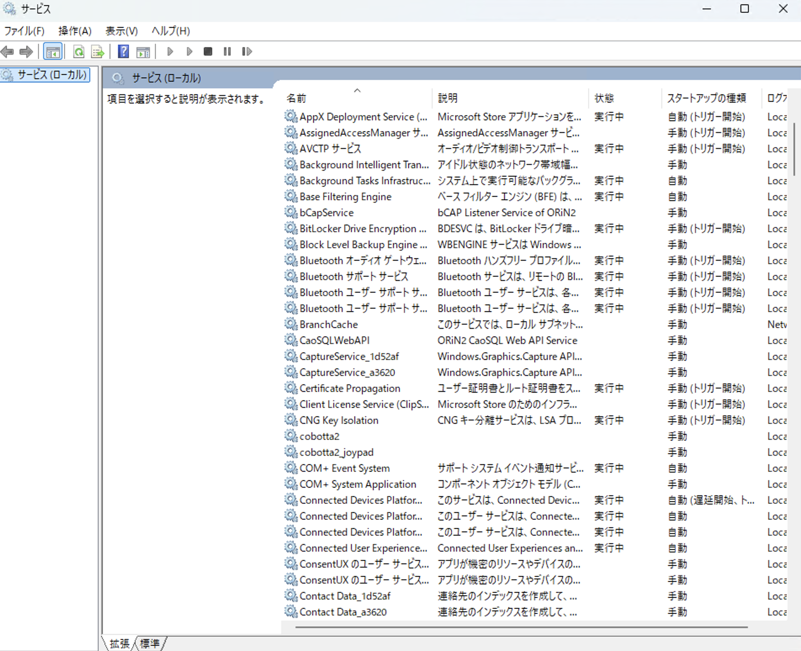
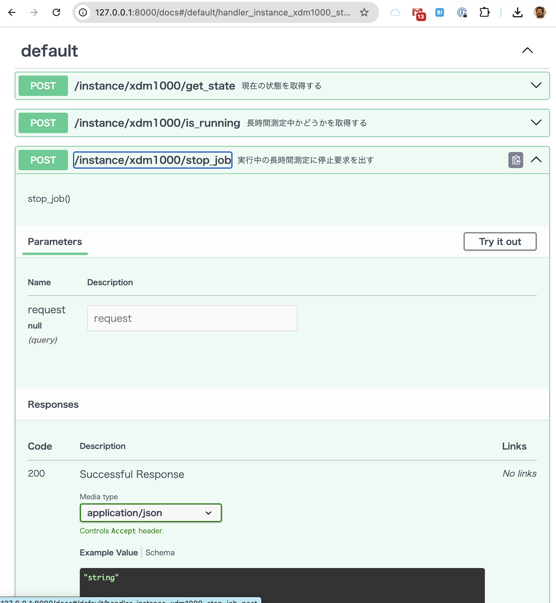

# XDM1000 サーバー起動およびクライアント測定チュートリアル

本ページでは、XDM1000 を FastAPI サーバーとして起動し、クライアント側から `DeviceProxy` を用いて電圧を 1 回測定する最小構成を示す。

## 前提

本チュートリアルでは、次の構成を前提とする。

- XDM1000 は USB シリアル経由で接続されている。
- シリアルポートは `/dev/cu.usbserial-10` である。
- サーバーは `127.0.0.1:8000` で起動する。
- クライアントは `ese774_frame.DeviceProxy` 経由で `Xdm1000Ctrl` に接続する。

シリアルポート名は環境により変わるため、実機環境に合わせて `PORT` または `xdm1000.yml` を修正すること。

## 設定ファイル

`xdm1000.yml` を作成する。

```yaml
# xdm1000 用設定例
SERVER_HOST: "127.0.0.1"
SERVER_PORT: 8000
CLIENT_LOGGER_NAME: "xdm1000_client"
SERVER_LOGGER_NAME: "xdm1000_server"

PORT: "/dev/cu.usbserial-10"
BAUDRATE: 115200
TIMEOUT: 2.0

LOGGER_LEVEL: "debug"
```


## サーバー起動スクリプト

次の内容で server_xdm1000.py を作成する

```python
#!/usr/bin/env python3
"""XDM1000 FastAPI サーバー起動例である。"""

from __future__ import annotations

from types import SimpleNamespace

from ese774_frame import FastApiServer

from xdm1000.xdm1000_ctrl import Xdm1000Ctrl
from xdm1000.server_fastapi.spec import xdm1000_api_spec
from xdm1000.server_fastapi.routers.xdm1000_router import Xdm1000Router

from x_logger import XLogger

# PORT = "/dev/cu.usbserial-140"
PORT = "/dev/cu.usbserial-10"
SERVER_HOST = "127.0.0.1"
SERVER_PORT = 8000


def main() -> None:
    """XDM1000 をサーバー側デバイスクラスとして起動する。"""
    config = SimpleNamespace(
        PORT=PORT,
        SERVER_HOST=SERVER_HOST,
        SERVER_PORT=SERVER_PORT,
        SERVER_LOGGER_NAME="xdm1000.server",
    )

    logger = XLogger(
        log_level="debug",
        logger_name=config.SERVER_LOGGER_NAME,
        log_mode="rotate",
        log_name=f"{config.SERVER_LOGGER_NAME}.log",
    )

    server = FastApiServer(
        device_cls=Xdm1000Ctrl,
        router_cls=Xdm1000Router,
        config=config,
        api_spec=xdm1000_api_spec,
        device_kwargs={"port": PORT},
        logger=logger,
        log_level="INFO",
        lifespan_msg_prefix="XDM1000",
    )
    server.run(
        host=SERVER_HOST,
        port=SERVER_PORT,
        reload=False,
    )


if __name__ == "__main__":
    main()
```

起動する。

```bash
python server_xdm1000.py
```

起動後、サーバーは上記で設定したのならば、localhost で待ち受ける

```
http://127.0.0.1:8000
```

## Windows サービス でのサーバースクリプトの起動

windows の場合は python によるサーバー起動を**サービス**として、
まるで Windows 上の機能として使うことができます。
(Windows ではバックグラウンドで動く機能をサービスと言います）

ただしこれは標準の機能ではなくて **NSSM** などのツールを使うことで実現できます。
たとえば、cobotta device サーバーが導入された PC では、これら、python プログラムはサービス化
して運用してます。サービスは Windows のサービスマネージャーで制御可能です



しかし、xdm1000 ではあえてサービス化まではしてません。

サーバーを立ち上げるマシンが、Linux か？ Mac か？ Windows か？も
よくわかってないです。トラブルが合ったときは、Python のまま起動しているのが
わかりやすいからです。

サービスは 権限として **System 権限** で動きます。そのユーザーの権限とそのユーザーの環境ではありません。
その点は注意してください。

### Linux デーモンでのサーバースクリプトの起動

Linux では systemctl によりバックグランドで動く機能を起動可能です。
バックグラウンドで動くこれらのプログラムは Unix ではデーモンと呼びます。

このデーモンは、Linux の時代により、initd 起動か？ systemd 起動なのか？で大きく違います(sp8 などでの古いシステムでは
この違いを認識することは非常に重要です)これらにより、python プログラムをデーモンとして自動起動できます


## web I/F (BL774互換)

Ese774_frame は OpenAPI により API を提供してます。BL774 互換です。
これらのAPIへは web I/F で接続できます



LabVIEW や VB など python 以外の言語から接続するときに用いてください


## クライアント計測スクリプト

ese774_frame をもちた xdm1000 では python
のクライアントライブラリも用意しています。
それを用いることで簡単に python プログラムで
計測シーケンスを組むことができます。

**async(非同期)** もしくは、**sync(同期)** の
プログラムが可能です。とりあえず、わかりやすいように
同期プログラムの参考例を下記に示します。

クライアントライブラリは

```text
- AsyncXdm1000Client():  非同期
- SyncXdm1000Client():  同期
```
の２つを用意してます。

これらを統合して選択して使うことができる
**DevcieProxy** というクラスライブラリも
同時に用意してます。

色々なクラス名を変数で切り替えて動的に使うことができます
ので活用してください。

この下記の例では、**DeviceClass** として Xdm1000Ctrl を
用いて、**DeviceProxy** 経由で 透過的に使うことを
意味します。

```python
#!/usr/bin/env python3
"""XDM1000 電圧測定サンプル"""

from ese774_frame import DeviceProxy
from xdm1000.server import SyncXdm1000Client

HOST = "127.0.0.1"
PORT = 8000


def main():
    # dmm = SyncXdm1000Client(HOST, PORT)
    # dmm = SyncXdm1000Client(config="xdm1000.yml")
    dmm = DeviceProxy("Xdm1000Ctrl", config="xdm1000.yml", async_mode=False)

    print(dmm.meas_one_shot("voltage_dc"))


if __name__ == "__main__":
    main()
```

